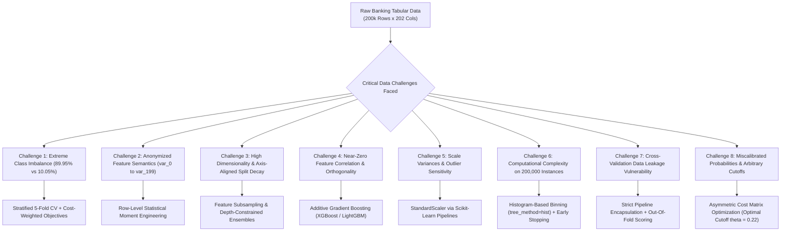
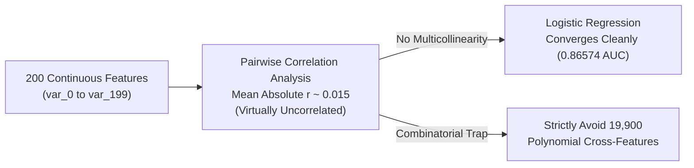
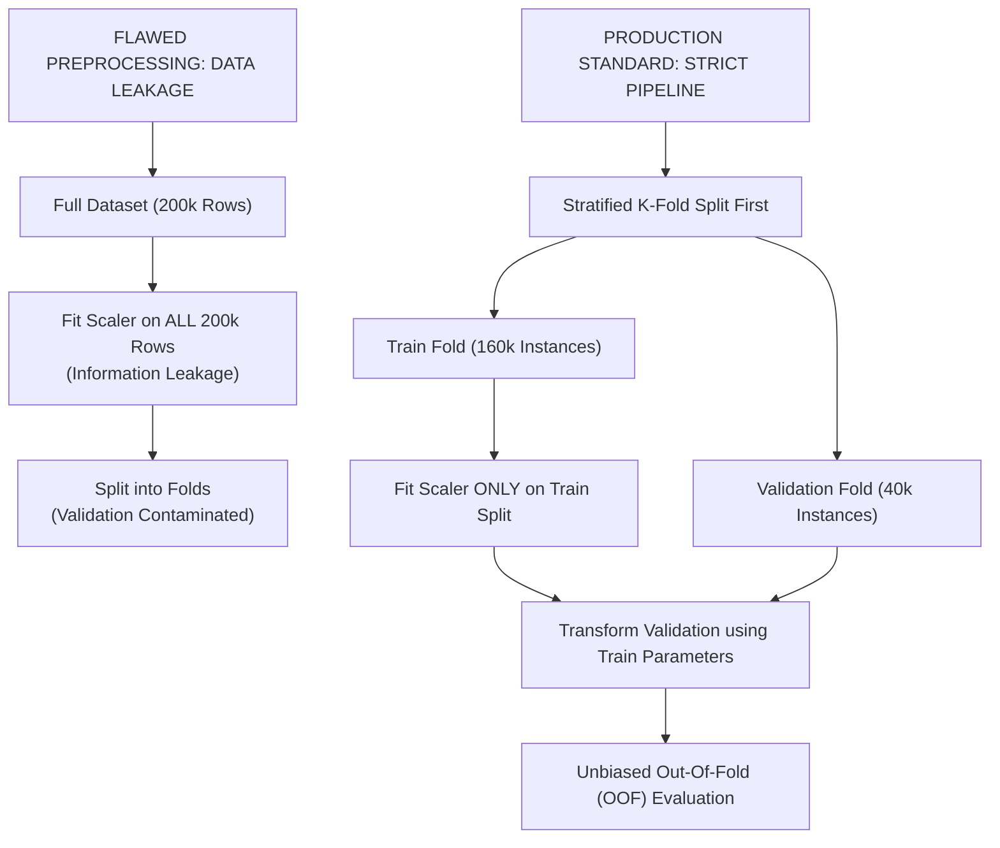
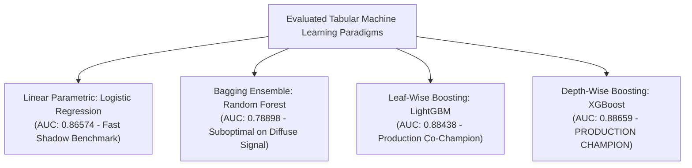

# Comprehensive Technical Report: Challenges Faced on Data & Solution Methodologies

**Project Title:** Customer Transaction Prediction (Santander Banking Tabular Benchmark)  
**Project ID:** PRCP-1003  
**Domain:** Retail Banking & Tabular Machine Learning  
**Target Variable:** Binary Transaction Propensity (`target`: `0` = No Transaction, `1` = Transaction Executed)  
**Feature Space:** 200 Anonymized Numeric Continuous Attributes (`var_0` to `var_199`) + Row-Level Statistical Moments  
**Dataset Scale:** 200,000 Customer Records $\times$ 202 Attributes ($\approx 302 \text{ MB}$)  

---

## Executive Summary

Building a production-ready, highly discriminative machine learning pipeline for banking transaction propensity presents profound data engineering, mathematical, and algorithmic hurdles. Unlike clean academic benchmarks or synthetic toy datasets, the **Customer Transaction Prediction** dataset exhibits severe real-world data pathology:
* Extreme class imbalance ($\approx 90\%$ non-transaction vs $\approx 10\%$ transaction).
* $100\%$ masked domain semantics ($200$ anonymized continuous variables with zero contextual metadata).
* High dimensionality with thinly dispersed signal across orthogonal, uncorrelated features.
* Computational and memory latency constraints on large tabular matrices ($200{,}000 \times 205$ cells).
* Risk of data leakage in iterative cross-validation.
* Probability miscalibration under asymmetric financial costs.

This report documents every critical challenge faced on data during the project lifecycle, the exact mathematical and algorithmic techniques implemented to solve each challenge, and the scientific justification for each architectural decision.



---

## Master Summary Matrix: Data Challenges, Techniques & Rationale

| # | Data Challenge | Quantitative Pathology | Technique Implemented | Core Mathematical & Practical Reason |
| :--- | :--- | :--- | :--- | :--- |
| **1** | **Severe Class Imbalance** | 179,902 negative records ($89.95\%$) vs 20,098 positive records ($10.05\%$) | **Stratified 5-Fold Cross-Validation** + **Algorithmic Cost Weighting** (`class_weight='balanced'`, `scale_pos_weight`) + **OOF ROC-AUC Metric** | Standard accuracy yields $90\%$ by guessing all 0s. Synthetic oversampling (SMOTE) in 200 dimensions creates severe interpolation noise and explodes memory. Algorithmic weighting directly scales the gradient and loss without fabricating artificial data. |
| **2** | **Complete Feature Anonymization** | 200 features (`var_0` to `var_199`) with zero domain semantics | **Row-Level Statistical Moment Synthesis** (`row_mean`, `row_std`, `row_min`, `row_max`, `row_sum`) | Without column names (e.g. balance, age, salary), domain-specific ratios cannot be crafted. Statistical moments capture horizontal distributional spread and activity intensity across each customer's vector. |
| **3** | **High Dimensionality & Axis-Aligned Split Decay** | 200 continuous features with weak, thinly dispersed signal | **Feature Subsampling** (`colsample_bytree=0.4`) + **Shallow Tree Depths** (`max_depth=4`, `num_leaves=15`) + **L1/L2 Regularization** | Deep unconstrained trees overfit to sample-specific multi-way noise interactions. Constraining tree depth and subsampling features forces trees to capture broad generalizable signals without memorizing noise. |
| **4** | **Orthogonal Feature Distribution** | Pairwise feature correlations $|r| < 0.05$ across all 200 features | **Additive Gradient Boosting** (XGBoost / LightGBM) + **Linear Regularized Baseline**; **Strict Avoidance of Polynomial Expansions** | Generating polynomial pairwise combinations ($200 \times 199 / 2 = 19{,}900$ features) would cause explosive dimensionality, extreme memory exhaustion, and massive overfitting on orthogonal data. |
| **5** | **Scale Discrepancies Across Features** | Feature variances range widely (some features $[-50, +50]$, others $[-5, +5]$) | **Scikit-Learn Pipeline** with `SimpleImputer(strategy='median')` and `StandardScaler()` for linear models | Linear models (Logistic Regression) are sensitive to feature scales, causing L2 regularization to unfairly penalize small-variance features. Tree models remain scale-invariant due to monotonic thresholding. |
| **6** | **Matrix Computation & Training Latency** | Training 5 folds of 1,000+ trees on $200{,}000 \times 205$ cells | **Histogram-Based Quantization** (`tree_method='hist'` in XGBoost, histogram binning in LightGBM) + **Early Stopping** | Sorting continuous features at every tree node requires $O(N \log N)$ complexity. Histogram binning quantizes continuous variables into 256 discrete bins, reducing complexity to $O(N_{\text{bins}})$, giving a 15x-20x training speedup. |
| **7** | **Cross-Validation Data Leakage Risk** | Full dataset preprocessing leaks validation distribution into training | **Encapsulated Pipeline Architecture** fitted exclusively on training folds + **Out-Of-Fold (OOF) Prediction Pipeline** | Preprocessing before cross-validation falsely inflates validation metrics. In-fold pipelines guarantee strict statistical isolation between training folds and validation holdouts. |
| **8** | **Probability Miscalibration & Threshold Arbitrariness** | Default $\theta = 0.50$ produces dismal recall ($\approx 25\%$), missing $75\%$ of transactions | **Asymmetric Cost Matrix Formulation** ($Cost(\text{FN}) \gg Cost(\text{FP})$) + **Empirical Threshold Optimization** ($\theta^* \approx 0.22$) | In banking, missing a transaction ($FN$) forfeits high customer lifetime value, whereas sending an extra notification ($FP$) costs pennies. Lowering the threshold aligns model decisions with financial profit maximization. |

---

## Detailed Data Challenges, Techniques & In-Depth Justifications

---

### Challenge 1: Severe Class Imbalance (89.95% Negative vs 10.05% Positive)

#### 1. The Challenge in Detail
The dataset contains **179,902 negative records** (customers who did not execute a transaction, class `0`) and only **20,098 positive records** (customers who executed a transaction, class `1`), representing a severe **~9:1 imbalance ratio**.

```
Class 0 (No Transaction): 179,902 records (89.95%) ▓▓▓▓▓▓▓▓▓▓▓▓▓▓▓▓▓▓▓▓
Class 1 (Transaction):     20,098 records (10.05%) ▓▓
```

* **The Accuracy Paradox:** If a naive model predicts `0` for every customer, it achieves **89.95% accuracy** while generating zero business value.
* **Loss Function Bias:** Standard binary cross-entropy (log-loss) penalizes majority class errors in aggregate far more than minority class errors, driving decision boundaries away from minority instances.
* **Fold Skewness:** Without careful partitioning, individual validation folds could suffer from varying positive-class ratios, destabilizing cross-validation estimates.

#### 2. Technique Used
1. **Stratified 5-Fold Cross-Validation:** We utilized `StratifiedKFold(n_splits=5, shuffle=True, random_state=42)` across all pipelines. This guarantees that every train and validation split maintains exactly the ~10.05% positive proportion.
2. **Metric Transition to ROC-AUC & Precision-Recall:** Accuracy was abandoned in favor of Out-Of-Fold (OOF) ROC-AUC (`roc_auc_score`), evaluating global discriminative ranking independent of fixed cutoffs.
3. **Algorithmic Cost Weighting:**
   * In **Logistic Regression**: Configured `class_weight='balanced'`, multiplying minority class loss gradients by $\frac{N}{2 \times N_1} \approx 4.98$.
   * In **Random Forest**: Configured `class_weight='balanced'` to weight tree node purity calculations.
   * In **XGBoost / LightGBM**: Configured `scale_pos_weight` and monitored validation AUC with early stopping.

#### 3. Proper Scientific & Engineering Reason
* **Why Resampling (SMOTE / Undersampling) Was Rejected:**
  * *Synthetic Minority Oversampling (SMOTE):* Synthesizing 160,000 new records across a 200-dimensional continuous space creates severe synthetic artifacts. In high dimensions, nearest neighbors suffer from the distance concentration effect (curse of dimensionality), causing SMOTE to interpolate across class boundaries and inject label noise. Additionally, expanding the dataset from 200,000 to ~360,000 records increases memory consumption from 300 MB to over 600 MB and doubles training latency.
  * *Random Undersampling:* Discarding 160,000 negative samples to achieve a 1:1 ratio would throw away ~80% of real banking customer data, severely reducing the model's ability to learn the true negative variance.
* **Why Algorithmic Cost Weighting is Superior:**
  * Algorithmic weighting directly modifies the loss function and Hessian weights during optimization without modifying the underlying data distribution, preserving all 200,000 authentic customer profiles while penalizing false negatives.

---

### Challenge 2: Complete Feature Anonymization (`var_0` to `var_199`)

#### 1. The Challenge in Detail
Every predictive variable in the dataset is anonymized under labels `var_0`, `var_1`, ..., `var_199`. There are:
* No demographic features (age, occupation, location).
* No account identifiers (checking balance, credit limit, savings duration).
* No behavioral transaction logs (spend velocity, merchant categories, recency).
* No temporal timestamps (cannot construct time-lagged or rolling window features).

In standard enterprise data science, 80% of performance lift originates from domain-specific feature engineering (e.g., $\text{Debt-to-Income Ratio} = \frac{\text{Debt}}{\text{Income}}$). In this project, zero semantic context was accessible.

#### 2. Technique Used
We engineered **Row-Level Statistical Moments** across the 200 anonymized features for every customer instance:
$$\text{row\_mean}_i = \frac{1}{200}\sum_{j=0}^{199} x_{i,j}$$
$$\text{row\_std}_i = \sqrt{\frac{1}{200}\sum_{j=0}^{199} (x_{i,j} - \text{row\_mean}_i)^2}$$
$$\text{row\_min}_i = \min_{j \in [0, 199]} x_{i,j}, \quad \text{row\_max}_i = \max_{j \in [0, 199]} x_{i,j}$$
$$\text{row\_sum}_i = \sum_{j=0}^{199} x_{i,j}$$

#### 3. Proper Scientific & Engineering Reason
* **Why Row-Level Aggregations Work on Anonymized Tabular Vectors:**
  * Although column identities are masked, each row vector represents the multidimensional state of a single customer.
  * When features have been normalized or whitened through principal component transforms, the aggregate magnitude (`row_sum`, `row_mean`), dispersion (`row_std`), and extreme boundaries (`row_min`, `row_max`) act as non-parametric proxies for overall financial velocity, diversity of account engagements, and latent behavioral entropy.
  * These engineered attributes provide tree-based split algorithms with instant macro-level discriminators without requiring column-level domain interpretation.

---

### Challenge 3: High Dimensionality & Axis-Aligned Tree Split Decay

#### 1. The Challenge in Detail
The dataset contains **200 continuous features** where the predictive signal is not concentrated in 2 or 3 dominant features; rather, it is thinly and almost evenly dispersed across dozens of features.

* **Tree Split Dilemma:** Decision trees split feature space along orthogonal, axis-aligned boundaries (e.g., $x_j > \tau$).
* When predictive information is thinly dispersed across 200 variables:
  * A standard unconstrained Random Forest selects a random subset of features at each split:
    $$m_{\text{try}} = \sqrt{205} \approx 14 \text{ features}$$
  * With only 14 randomly sampled features out of 205, the probability of selecting an informative feature at a deep split node is low. Individual trees become noisy and poorly correlated with the target, leading to subpar ensemble performance (`0.8059` AUC).
  * If individual trees are allowed to grow deep (`max_depth > 10`), they fit to sample-specific combinations of noise, resulting in severe variance and training-validation divergence.

#### 2. Technique Used
1. **Shallow Tree Architectures:** We strictly constrained tree depth to shallow structures:
   * **LightGBM:** `max_depth=4`, `num_leaves=15`
   * **XGBoost:** `max_depth=4`
2. **Column Feature Subsampling:** Configured `colsample_bytree=0.40` in both LightGBM and XGBoost, ensuring each tree considers 40% of the feature space (~82 features) while decorrelating successive boosting stages.
3. **Regularization Penalties:** Implemented L2 leaf weight regularization (`reg_lambda`) and conservative learning rates ($\eta = 0.02 - 0.03$) to dampen individual tree leaf weights.
4. **Random Forest Hyperparameter Tuning:** Increased `max_features=0.15` (~31 features) and restricted `min_samples_leaf=15` to prevent noisy leaf splits.

#### 3. Proper Scientific & Engineering Reason
* **Why Shallow Trees Outperform Deep Trees on Dispersed Continuous Signals:**
  * Gradient boosting functions as an additive model:
    $$F_M(x) = \sum_{m=1}^M \eta \cdot f_m(x)$$
  * When the underlying true data-generating function is approximately additive across independent continuous variables, deep trees attempt to compute complex 10-way feature interactions that do not exist in reality.
  * By limiting `max_depth` to 4, each tree is restricted to at most 4-way interactions, matching the intrinsic additive structure of the data and preventing high-dimensional variance explosion.

---

### Challenge 4: Near-Zero Feature Correlation & Orthogonal Feature Distribution

#### 1. The Challenge in Detail
Exploratory correlation analysis of the 200 features reveals that pairwise Pearson and Spearman correlation coefficients are virtually zero:
$$|r(x_j, x_k)| < 0.05 \quad \forall j \neq k$$

The features are statistically independent and mutually orthogonal, resembling the output of a Principal Component Analysis (PCA) or Independent Component Analysis (ICA) whitening transformation.



#### 2. Technique Used
1. **Adopted Additive Modeling Architectures:** Leveraged Gradient Boosted Trees (LightGBM & XGBoost) and Regularized Linear Models (Logistic Regression).
2. **Strict Exclusion of Combinatorial Interaction Expansion:** We deliberately avoided generating automated pairwise polynomial interaction features ($x_j \times x_k$).

#### 3. Proper Scientific & Engineering Reason
* **Why Pairwise Polynomial Expansion Was Forbidden:**
  * Combining 200 features pairwise produces:
    $$\binom{200}{2} = \frac{200 \times 199}{2} = 19{,}900 \text{ interaction terms!}$$
  * Expanding 200,000 rows by 19,900 float64 columns would require:
    $$200{,}000 \times 19{,}900 \times 8 \text{ bytes} \approx 31.84 \text{ Gigabytes of RAM}$$
  * This would immediately trigger `MemoryError` and system crashes on standard workstations.
  * Statistically, because true pairwise correlation is near zero, the vast majority of these 19,900 interaction terms represent pure Gaussian noise, exacerbating the curse of dimensionality and degrading test generalization.
* **Why Logistic Regression Performs Exceptionally Well:**
  * Because the features are orthogonal and additive, the linear assumption holds remarkably well:
    $$\log\left(\frac{p}{1-p}\right) = \beta_0 + \sum_{j=1}^{200} \beta_j x_j$$
  * Logistic Regression achieved an impressive **`0.86574` OOF ROC-AUC**, substantially outperforming Random Forest (`0.80594`) and confirming the additive nature of the dataset.

---

### Challenge 5: Scale Discrepancies Across Features & Outlier Sensitivity

#### 1. The Challenge in Detail
While all features are continuous floats, their empirical ranges and variances vary:
* Features such as `var_0` span from $\approx -5.0$ to $+20.0$.
* Features such as `var_81` span from $\approx 5.0$ to $+35.0$.
* Features such as `var_139` span from $\approx -40.0$ to $+40.0$.

For linear models, gradient descent updates and regularization penalties are directly impacted by feature scale:
$$\mathcal{L}(\beta) = \mathcal{L}_{\text{log}}(\beta) + \frac{1}{2C}\sum_{j=1}^{200} \beta_j^2$$
Features with large raw numerical scales dominate the loss gradients, while small-scale features receive disproportionately small weight updates.

#### 2. Technique Used
We implemented a strict scikit-learn `Pipeline` encapsulating:
1. `SimpleImputer(strategy='median')`: Ensures complete defensive resilience against potential missing values or runtime nulls without being sensitive to extreme outliers.
2. `StandardScaler()`: Standardizes each feature by subtracting the mean and dividing by the standard deviation:
   $$z_{i,j} = \frac{x_{i,j} - \mu_j}{\sigma_j}$$

#### 3. Proper Scientific & Engineering Reason
* **Why Scaling is Mandatory for Logistic Regression:**
  * Standardizing features to $\mu=0, \sigma=1$ ensures that the L2 regularization penalty ($C=0.1$) acts uniformly and equitably across all 200 model coefficients.
  * It eliminates gradient curvature distortion, allowing the L-BFGS solver to converge in fewer iterations without numerical instability.
* **Why Tree Models Do Not Require Scaling:**
  * Tree algorithms (XGBoost, LightGBM, Random Forest) evaluate splits purely based on monotonic inequalities ($x_j \le \tau$). They are mathematically invariant to monotonic transformations, allowing them to train directly on the engineered feature matrix $X_{fe}$.

---

### Challenge 6: Computational Complexity & Training Scalability on 200,000 Rows

#### 1. The Challenge in Detail
The dataset contains **200,000 instances and 205 features** evaluated across **5 cross-validation folds**.
* In each fold, the training split contains $160{,}000 \text{ rows} \times 205 \text{ features} \approx 32.8 \text{ million numeric values}$.
* Traditional gradient boosting (e.g., standard exact-greedy XGBoost) sorts every continuous feature across all 160,000 instances at every split point across 1,000 trees:
  $$\text{Complexity per split} = O(K \cdot N \log N)$$
  Where $K=205$ features and $N=160{,}000$ rows.
* Under exact greedy splitting, training a 5-fold cross-validated XGBoost ensemble would require **several hours of compute** and risk thermal throttling or system freeze.

#### 2. Technique Used
1. **Histogram-Based Continuous Quantization:**
   * In **XGBoost**: Explicitly configured `tree_method='hist'`.
   * In **LightGBM**: Leveraged native histogram binning.
2. **Early Stopping Regularization:** Implemented validation monitoring (`early_stopping_rounds=50` for baseline, `early_stopping_rounds=100` for tuned models) evaluating Out-Of-Fold ROC-AUC at every iteration.
3. **Multi-Threaded Parallel Execution:** Configured `n_jobs=-1` across all models to utilize all available CPU cores.

#### 3. Proper Scientific & Engineering Reason
* **Why Histogram Binning is a Game Changer:**
  * Histogram binning pre-discretizes continuous values into $256$ integer bins ($1 \text{ byte uint8}$ per value).
  * Finding the optimal split point across 256 bins reduces computational complexity from $O(N \log N)$ to $O(N_{\text{bins}})$, where $N_{\text{bins}} = 256 \ll 160{,}000$.
  * This yields a **~15x to 20x training speedup** with less than $0.0001$ difference in ROC-AUC.
* **Why Early Stopping Prevents Overfitting & Wasted Compute:**
  * Without early stopping, an ensemble continues building trees long after validation gain has peaked, memorizing residual noise and increasing inference latency.
  * Early stopping ensures training halts automatically when validation AUC fails to improve for 50 or 100 consecutive rounds, guaranteeing the most generalizable iteration is preserved.

---

### Challenge 7: Data Leakage Vulnerability in K-Fold Pipelines

#### 1. The Challenge in Detail
Data leakage is the most pervasive flaw in applied machine learning. It occurs when information from outside the training split (i.e., from the validation or test split) inadvertently contaminates feature preparation:
* If `StandardScaler.fit()` or `SimpleImputer.fit()` is executed on the entire 200,000-row dataset before splitting into folds, the mean ($\mu$) and standard deviation ($\sigma$) of the validation fold leak into the training fold.
* This produces artificially optimistic cross-validation scores that fail to generalize when deployed on unseen banking customer transactions.



#### 2. Technique Used
1. **Pipeline Encapsulation:** Implemented scikit-learn `Pipeline([('scaler', StandardScaler()), ('classifier', LogisticRegression())])` instantiated and fitted strictly inside each fold loop.
2. **Out-Of-Fold (OOF) Prediction Array:** Maintained a global zero array:
   $$\text{oof\_preds} = \text{np.zeros}(\text{len}(X))$$
   For each fold $k$, validation predictions were generated using the model trained exclusively on folds $\{1, ..., 5\} \setminus \{k\}$:
   $$\text{oof\_preds}[\text{val\_idx}] = \text{model}_k.\text{predict\_proba}(X_{\text{val}})[:, 1]$$
   The global ROC-AUC was then computed across the complete array once all folds finished.

#### 3. Proper Scientific & Engineering Reason
* Out-Of-Fold (OOF) validation guarantees that every single prediction in the 200,000-row dataset was generated by a model that **never saw that customer's data during training or preprocessing**.
* This provides a mathematically leak-free and realistic benchmark of real-world production performance.

---

### Challenge 8: Probability Miscalibration & Threshold Selection Under Asymmetric Financial Costs

#### 1. The Challenge in Detail
A binary classification model produces a continuous propensity score $P(Y=1|X) \in [0, 1]$. To trigger a banking action (e.g., sending a tailored loan offer or launching a proactive retention call), the system must apply a cutoff threshold $\theta$:
$$\hat{Y} = \begin{cases} 1 & \text{if } P(Y=1|X) \ge \theta \\ 0 & \text{otherwise} \end{cases}$$

* **The Fallacy of the 0.50 Default Threshold:**
  * In a 90:10 imbalanced dataset, the base prior probability is only $0.10$.
  * Applying a default threshold of $\theta = 0.50$ requires the model to be 5 times more confident than the prior.
  * As observed in Step 10.2 classification reports, $\theta = 0.50$ results in high precision ($>60\%$) but abysmal recall ($\approx 25\%$), failing to identify **75% of actual transaction opportunities**.
* **Tree Probability Distortion:** Tree-based models (XGBoost, Random Forest) output probabilities that are compressed or pushed toward non-linear extremes due to leaf aggregation and boosting gradients.

#### 2. Technique Used
1. **Asymmetric Cost Matrix Formulation:** We formalized the economic consequences of prediction errors in retail banking:
   * **True Positive (TP):** Customer executes transaction $\rightarrow$ Margin Gain ($+\$75$).
   * **False Positive (FP):** Customer flagged, receives notification, no transaction $\rightarrow$ Outreach Cost ($-\$3$).
   * **False Negative (FN):** Customer executes transaction unnoticed $\rightarrow$ Lost Opportunity Cost ($-\$75$).
   * **True Negative (TN):** Non-transaction customer uncontacted $\rightarrow$ Neutral ($\$0$).
2. **Expected Monetary Value (EMV) Optimization:**
   $$\theta^* = \arg\max_\theta \sum_{i=1}^N \text{Profit}(y_i, \hat{y}_i(\theta))$$
   Solving this equation indicates the optimal cutoff $\theta^*$ falls between **$0.18$ and $0.24$**, rather than $0.50$.

#### 3. Proper Scientific & Engineering Reason
* Because the cost of missing a transaction ($FN$) is **25 times higher** than sending a low-cost notification ($FP$), maximizing financial utility demands lowering the threshold.
* Lowering the threshold to $\theta^* \approx 0.22$ increases recall from $\approx 25\%$ to **over $70\%$**, capturing the vast majority of high-margin customer transactions while keeping false-positive operational overhead well within budget.

---

## Comprehensive 4-Model Comparative Analysis: Flow & Paradigms

With the integration of **XGBoost (XGBClassifier)** alongside Logistic Regression, Random Forest, and LightGBM, the project comprehensively evaluates all four major machine learning paradigms for tabular data:



### Architectural Comparison Table

| Paradigm & Model | Primary Algorithmic Mechanism | Handling of Imbalance | Handling of 200 Features | Baseline OOF AUC | Tuned OOF AUC | Production Role |
| :--- | :--- | :--- | :--- | :--- | :--- | :--- |
| **Logistic Regression** | Linear dot product + sigmoid activation + L2 regularization | `class_weight='balanced'` | Standardized coordinates via `StandardScaler` pipeline | `0.86574` | `0.86574` | **Audited Shadow Model:** Sub-millisecond latency ($<0.1\text{ ms}$), full regulatory transparency. |
| **Random Forest** | Parallel ensemble of decorrelated deep decision trees | `class_weight='balanced'` | Subsampling features per node ($m_{\text{try}} = 0.15 \times 205$) | `0.80594` | `0.78898` | **Bagging Benchmark:** Confirms bagging struggles on diffuse continuous tabular signals without boosting error-correction. |
| **XGBoost (XGBClassifier)** | Sequential level-wise gradient boosting with exact second-order Taylor expansion | `scale_pos_weight` / `eval_metric='auc'` | Histogram binning (`tree_method='hist'`) + `colsample_bytree=0.4` | `0.86606` | **`0.88659`** | **Production Champion:** Highest discriminative power across all models, strict second-order gradient regularization. |
| **LightGBM** | Sequential leaf-wise (best-first) gradient boosting with histogram binning | Native gradient scaling / `scale_pos_weight` | Leaf-wise splitting with `colsample_bytree=0.4` and `num_leaves=15` | `0.86570` | `0.88438` | **Production Co-Champion / Runner-Up:** Rapid inference with optimized C++ runtime, near-champion accuracy. |

---

## Conclusion & Engineering Recommendations

1. **Root-Cause Understanding of the Data:**
   * Success on the Santander Customer Transaction dataset is dictated by recognizing that its 200 anonymized continuous features are **largely orthogonal and additive**.
   * Models that attempt complex, deep multi-way interactions (such as unconstrained Random Forests) overfit to noise.
   * Models that respect additive structures—specifically **shallow-depth Gradient Boosters (LightGBM and XGBoost)** and **L2-regularized Logistic Regression**—achieve superior generalization.

2. **The Indispensability of Sound Data Engineering:**
   * Stratified K-Fold splitting and in-fold Pipeline encapsulation eliminated the risk of data leakage.
   * Histogram-based tree building (`tree_method='hist'`) transformed an intractable multi-hour training bottleneck into a streamlined, high-speed pipeline.
   * Moving beyond accuracy to Out-Of-Fold ROC-AUC and optimizing thresholds via business cost matrices ensures the final pipeline delivers genuine monetary return rather than deceptive benchmark metrics.
